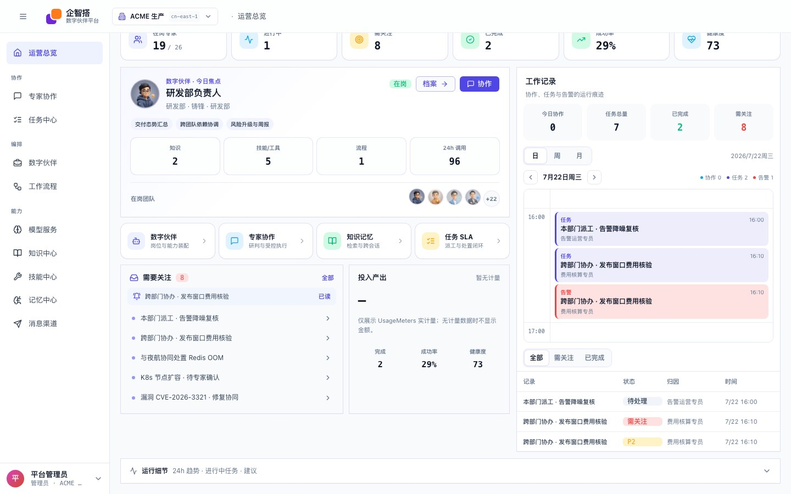
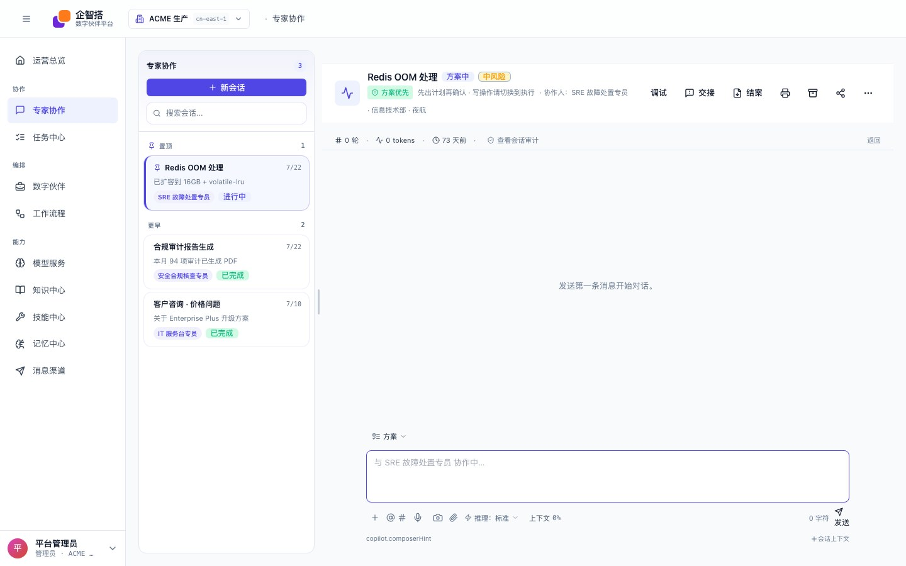
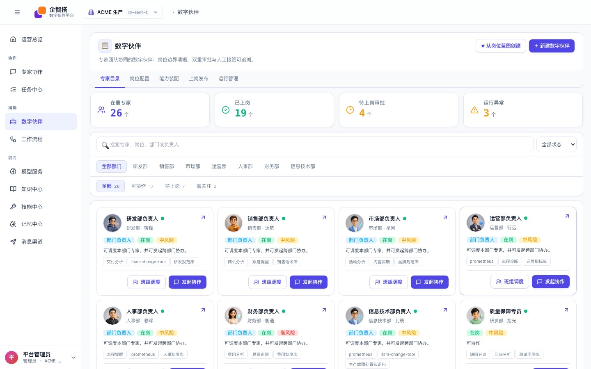
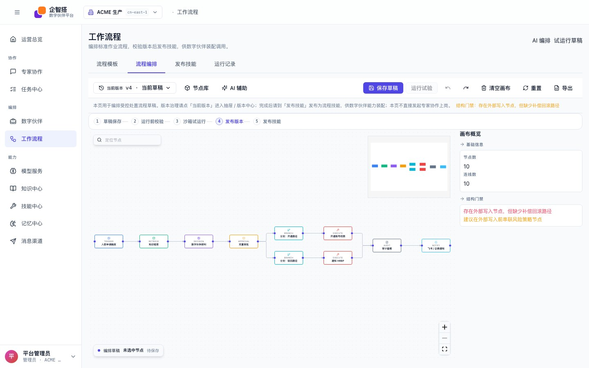
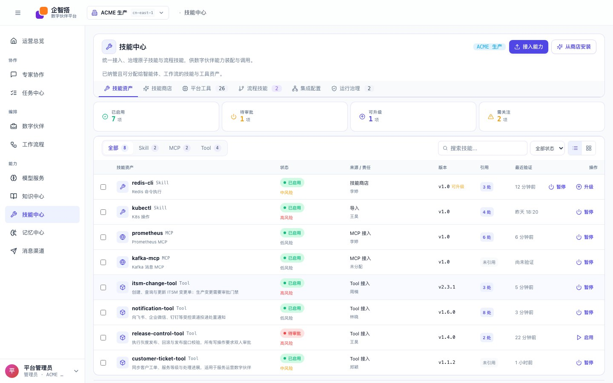
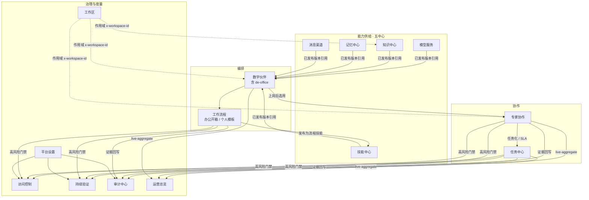
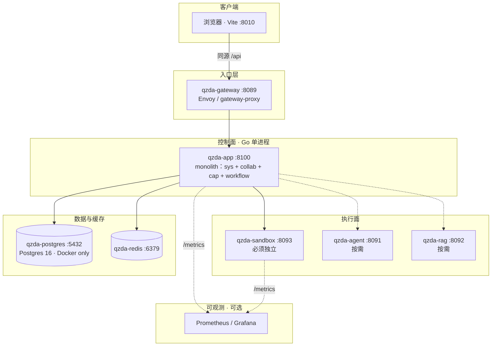
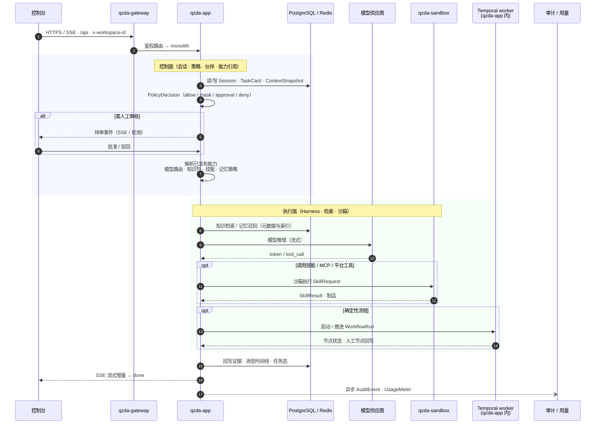

<p align="center">
  
</p>

<p align="center">
  <strong>企业级「数字伙伴」编排与治理控制台</strong><br/>
  把大模型、企业知识、技能/工具与工作流，装配为可上岗的数字伙伴，在受控边界内完成协作、执行与审计。
</p>

<p align="center">
  <em>安全零信任 · 驱动先进生产力 · 成本新范式</em>
</p>

<p align="center">
  <a href="#快速开始"></a>
  <a href="#功能模块"></a>
  <a href="../../blob/main/LICENSE"></a>
  <a href="../../actions"></a>
  <a href="../../releases"></a>
</p>

<p align="center">
  <a href="#项目介绍">项目介绍</a> ·
  <a href="#产品价值">产品价值</a> ·
  <a href="#重点产品讲解">重点产品</a> ·
  <a href="#快速开始">快速开始</a> ·
  <a href="#功能模块">功能模块</a> ·
  <a href="#技术架构">技术架构</a> ·
  <a href="#本地部署">本地部署</a>
</p>

---

##  项目介绍

**企智搭（QIZHIDA）· 数字伙伴平台** 是一个面向企业组织的 **AI Agent 编排与治理控制面**：将大模型、企业知识（Knowledge / RAG）、技能 / MCP / 工具 与 工作流 装配为可被人类员工调用的 **岗位数字伙伴**（Digital Partner），在受控边界内完成客服、SRE、运维、合规、研发等重复性工作。

> 与模型广场 / Prompt 玩具 / 裸跑 Agent 控制台不同，企智搭以「**谁在岗、能否托付、如何协同**」为中心运营：**岗位级**数字伙伴，有职责、有边界、有版本、有证据；能力分控制面治理，伙伴**只引用已发布版本**。

**冷启动即带「办公开箱」**（知识 × 技能 × 流程 + 出厂 `de-office` 办公助手）：制度问答、会议纪要、周报、假勤出差、报销自查、会议预约等场景无需先手工灌库。

---

##  产品价值

### 我们相信什么

| 我们是 | 我们不是 |
|--------|----------|
| 以「谁在岗、能否托付、如何协同」为中心的运营控制面 | 模型广场、Prompt 玩具或裸跑 Agent 控制台 |
| 岗位级数字伙伴：有职责、有边界、有版本、有证据 | 一次性对话机器人 |
| 能力分控制面治理，伙伴只引用已发布版本 | 把模型 / 知识 / 技能堆在同一页里任选即用 |

### 三大产品价值

| 支柱 | 含义 | 落地 |
|------|------|------|
| ️ **安全零信任** | 持续验证守住身份、权限、数据与执行边界 | 工作区硬隔离、双签、SoD、零信任决策（allow / mask / approval / deny）、审计只读 |
|  **驱动先进生产力** | 把 AI 能力转化为可托付的岗位产出 | 数字伙伴装配上岗、人机协同、办公开箱即用、任务 / 流程闭环 |
|  **成本新范式** | 让每一次协同可度量、可优化 | live-aggregate 运营总览、UsageMeters 成本卡片、预算归属、ROI 视角 |

### 价值流转

```text
能力接入（含办公开箱预置） → 装配上岗 → 受控协同（研判 / 执行 / 审核 / 流程） → 运营复盘与审计
```

---

##  重点产品讲解

###  数字伙伴（Digital Partner）— 平台核心

**不是聊天机器人，而是岗位。** 你可以为「客服」「制度助手」「运维值守」「研发代码助手」等真实岗位定义职责边界；它有版本、有证据、有上岗审核。

-  **职责与边界**：定义可访问的能力、可执行的动作、不可触达的禁区
-  **能力装配**：只引用五中心已发布版本（模型 / 知识 / 技能 / 记忆 / 渠道）
-  **上岗审核**：发布须经管理员审批（admin 可自批，user 须他人会签）
-  **运行证据**：所有动作留痕可审计

**典型岗位示例**：`de-office`（出厂办公助手）、`hr-policy-bot`（制度问答）、`ops-runbook-agent`（运维剧本执行）。

###  办公开箱 — 第一天就能干活

无需先手工灌库；冷启动即带 **10 包部门化知识 × 9 个办公岗位技能 × 21 个流程模板 + 1 个办公伙伴**。

| 入口 | 体验 |
|------|------|
| **工作流程 → 流程模板** | 「平台内置 / 个人创建」；默认筛 **办公通用**；卡片展示配套知识 / 技能 |
| **数字伙伴** | 出厂 **办公助手** `de-office` |
| **知识中心** | `kp.{hr,admin,sales,market}.*` 10 包冷启动 published（人事 3 / 行政 4 / 销售 2 / 市场 1） |
| **技能中心** | 岗位包 `office` 对各工作区 `autoInstall` |

###  专家协作（Copilot）— 多气泡回合 + 上下文联动

与在岗伙伴对话；流式增量、工具调用可视化、人工审核门禁、双签交接。

- 推理档位（省 / 标准 / 深）+ 上下文占用可视化
- 工作卡 / ThoughtPanel / 附件 / @ 引用 / 命令插入
- 高风险操作 → 待审事件 → 批准 / 驳回 → 落地
- 多气泡回合 + 能力调用 + 右侧上下文面板联动

### ️ 信任治理三件套

| 模块 | 能力 |
|------|------|
| **访问控制** | RBAC（admin / user / auditor）、发布审批、SoD 职责分离 |
| **持续验证** | 零信任策略、临时授权、运行时决策（allow / mask / approval / deny） |
| **审计中心** | 只读追溯、脱敏导出、证据回写（会话 / 任务 / 流程 / 决策） |

### ️ 五中心能力供给

| 中心 | 关键能力 |
|------|----------|
|  **模型服务** | 供应商接入、路由发布 / 回滚、治理演练、审计 |
|  **知识中心** | 资产加工、检索 / 图谱、引用追踪；含办公开箱 10 包 |
| ️ **技能中心** | 启用清单 / 技能商店 / MCP 集成 / 岗位包 / 流程技能 |
|  **记忆中心** | 短时 / 工作 / 长期三层记忆、向知识中心输送候选（须审核） |
|  **消息渠道** | 飞书 / 钉钉 / 企微 / 个人微信；投递 / 健康 / 死信 / 审计 |

###  运营总览 — 直播聚合

不是 PPT，是 live-aggregate：KPI、需关注、团队动态、在岗伙伴、任务态、成本卡片（仅当 UsageMeters 存在时显示金额，否则 `—`）。

---

##  快速开始

本机联调（**monolith** + 真实网关）最短路径，**约 2 分钟**：

```bash
# 1) Docker Postgres 16（勿用 Homebrew 抢 5432）
bash scripts/dev-stack/ensure-docker-postgres.sh

# 2) 控制面
cd backend && make compose-up-monolith
curl -sS http://127.0.0.1:8089/healthz

# 3) 前端
cd ../frontend && pnpm install && pnpm --filter web dev
# 打开 http://127.0.0.1:8010 ，用 admin@… 登录（密码任意非空）
```

**验收清单**：

1. **数字伙伴** → 可见 `de-office` 办公助手  
2. **工作流程 → 流程模板** → 默认「办公通用」；可切「个人创建」  
3. **知识 / 技能中心** → 办公知识包 published；岗位包 `office` 已安装  
4. **专家协作** → 选用办公助手做一次制度问答或纪要类对话  

改 Go 后须重编：`cd backend && make build`，再 `launchctl kickstart -k "gui/$(id -u)/com.qizhida.dev-stack"`。完整部署见 [本地部署](#本地部署)。

---

## ️ 控制台一览

| 运营总览 | 专家协作 |
|:-------:|:-------:|
|  |  |
| 在岗 KPI、数字伙伴与工作记录直播聚合 | 与在岗伙伴流式协同；问答 / 方案 / 执行 |

| 数字伙伴 | 工作流程 |
|:-------:|:-------:|
|  |  |
| 专家目录、上岗状态与进入对话 | 办公开箱流程编排（如 `wf.office.expense_precheck`） |

| 技能中心 |
|:-------:|
|  |
| 启用清单 / 技能商店 / 平台工具；含办公相关技能 |

> 原图：[`docs/images/product/`](docs/images/product/)。

---

## ️ 功能模块

侧栏按**用户工作顺序**组织；底层 Agent 只作执行内核，**不作**一级入口。  
细则见 [`docs/README.md`](docs/README.md)（按模块分册）。

### 导航信息架构

```text
运营总览                                              ← 度量入口
协作：专家协作 → 任务中心                              ← 人机处置
编排：数字伙伴 → 工作流程                              ← 岗位与确定性路径
能力：模型 → 知识 → 技能 → 记忆 → 渠道                 ← 已发布资产供给
账号：工作区 · 平台设置
        └─ 访问控制 · 持续验证 · 审计中心              ← 信任治理
```

**角色可见性**（摘要）：`admin` 全量；`user` 侧重协作 / 已授权伙伴；`auditor` 侧重审计只读。

### 功能模块交互图

能力中心**发布版本**，编排模块**只引用**；协同与流程受审核 / 零信任约束，结果回写运营与审计。



### 典型闭环

1. **能力接入** → 五中心配置并发布（办公开箱已预置知识 / 技能）  
2. **装配上岗** → 伙伴绑定已发布版本（可直接用 `de-office`）  
3. **受控协同** → 专家协作或任务 / 流程处置；高风险走审核  
4. **复盘治理** → 运营总览看结果；审计中心留证据  

> 办公快捷路径：流程模板（办公通用）或直接与 `de-office` 对话。

### 模块一览（15 个一级模块）

| ID | 模块 | 路由 | 分组 | 一句话 | 状态 |
|----|------|------|------|--------|------|
| **M01** | 运营总览 | `/home` | 运营 | 直播 KPI、需关注、投入产出、工作记录 |  |
| **M02** | 专家协作 | `/copilot` | 协作 | 与在岗伙伴会话；研判 / 执行、审核、交接 |  |
| **M03** | 任务中心 | `/tasks` | 协作 | 任务生命周期、复核与 SLA |  |
| **M04** | 工作区 | `/workspaces` | 账号 | 业务域隔离、环境与配额 |  |
| **M05** | 数字伙伴 | `/partners` | 编排 | 岗位装配与上岗；含 `de-office` |  |
| **M06** | 工作流程 | `/workflows` | 编排 | 办公开箱 / 部门 / 个人模板；画布与发布 |  |
| **M07** | 模型服务 | `/models` | 能力 | 供应商、路由发布 / 回滚、治理审计 |  admin |
| **M08** | 知识中心 | `/knowledge` | 能力 | 资产与知识包；含办公开箱 10 包 |  |
| **M09** | 技能中心 | `/skills` | 能力 | 清单 / 商店 / 岗位包（含 `office`）/ 流程技能 |  |
| **M10** | 记忆中心 | `/memory` | 能力 | 三层记忆、晋升候选 |  admin |
| **M11** | 消息渠道 | `/channels` | 能力 | 飞书 / 钉钉 / 企微等接入与投递 |  admin |
| **M12** | 平台设置 | `/settings` | 账号 | 组织壳与运营设置 |  admin |
| **M13** | 访问控制 | settings / 独立 | 治理 | 授权、发布审批、SoD |  |
| **M14** | 持续验证 | settings / 独立 | 治理 | 零信任策略与临时授权 |  |
| **M15** | 审计中心 | settings / 独立 | 治理 | 只读追溯与脱敏导出 |  |

### 重点模块详解

#### M05 · 数字伙伴（核心编排）

**功能**：定义岗位数字伙伴，绑定已发布版本的能力组合，经审核后上岗。  
**关键路径**：`/partners` → 选择 / 新建岗位 → 装配模型 / 知识 / 技能 / 记忆 → 评测 → 上岗审核 → 进入「专家协作」被调用。  
**亮点**：

- **版本化**：每次发布都有版本号；可回滚
- **岗位独立**：权限与边界跟随岗位，非跟随个人
- **审计可追**：上线、下线、调用全部留痕

#### M02 · 专家协作

**功能**：与已上岗伙伴对话，研判 / 执行 / 交接一体化。  
**关键路径**：`/copilot` → 选伙伴 → 问 / 解 / 执行 → 流式增量 → 工作卡 / 工具调用 → 待审（高风险）→ 落地。  
**亮点**：

- 推理档位（省 / 标准 / 深）+ 上下文占用可视化
- 多气泡回合 + 能力调用 + 右侧上下文面板联动
- ThoughtPanel / 附件 / @ / 命令插入
- 高风险门禁：写操作身份绑定双签

#### M06 · 工作流程

**功能**：把确定性流程画出来，沉淀为可发布的流程技能。  
**关键路径**：`/workflows` → 选模板（平台内置 / 个人创建）→ 画布编排 → 试运行 → 发布为技能 → 进入技能商店。  
**亮点**：

- **办公开箱模板**：11 个办公通用流程（`wf.office.*`）
- **部门 Certified**：9 个部门级模板 + 1 个高级库模板
- **可发布为技能**：流程可被伙伴引用

#### M08 · 知识中心

**功能**：管理资产与知识包，含办公开箱 10 包。  
**关键路径**：`/knowledge` → 资产上传 → 加工 → 评测 → 发布 → 知识包形式被伙伴引用。  
**亮点**：

- **办公开箱 10 包**：按部门归类 `kp.{hr,admin,sales,market}.*`
- **图谱与引用**：跨包引用追踪，避免重复灌库

#### M15 · 审计中心

**功能**：只读追溯所有证据；脱敏导出。  
**亮点**：审计员角色专属视图；不参与决策，只读 + 导出。

---

## ️ 技术架构

**控制面管可信与编排，执行面跑推理与工具，网关统一入口。**  
本地 / SME 默认 **monolith**：`qzda-gateway:8089` → `qzda-app:8100` + `qzda-sandbox:8093`（可选 agent / rag sidecar，按需启动进程内 Temporal worker）。

| 文档 | 用途 |
|------|------|
| [`docs/README.md`](docs/README.md) | 功能模块文档索引（M01–M15 分册） |
| [`backend/deploy/topology-split.md`](backend/deploy/topology-split.md) | monolith 拓扑说明 |

### 文档分层

| 层 | 含义 | 现状 |
|----|------|------|
| **L0 控制面** | IA、模块能力、角色与治理闭环 | React 控制台 + monolith 联调（Mock 可选） |
| **L1 领域契约** | 工作区、权限、审核、零信任、审计事件 | 契约已落地；企业写路径持续硬化 |
| **L2 运行时底座** | Temporal、Milvus、真沙箱、K8s、SPIRE 等 | 选型锁定，按阶段补齐 |

### 架构原则

| 原则 | 含义 |
|------|------|
| **粗粒度部署** | 默认 monolith（`qzda-app` 单进程 + 可选 sidecar） |
| **双栈分工** | Go：身份、策略、审计、资源编排；Python：Agent / RAG / Skill 沙箱 |
| **网关统一入口** | 浏览器只认 `:8089`；Vite 开发态同源 `/api` 代理到网关 |
| **工作区硬隔离** | 请求带 `x-workspace-id`；跨工作区引用拒绝 |
| **执行面不混部** | sandbox 必须独立；agent / rag 按需 |
| **能力只引用已发布** | 伙伴装配模型 / 知识 / 技能 / 渠道的已发布版本 |
| **可观测默认开** | 各服务 `/metrics`（含 `service` label） |

### 部署架构图

本机 / SME 默认 **Compose monolith**。浏览器只认网关 `:8089`。



| 形态 | 组成 | 适用 |
|------|------|------|
| **monolith（默认）** | gateway + qzda-app + sandbox（± agent / rag） | 本地联调 / SME / 单租户 |
| **staging 拓扑** | monolith + Dex + OPA + OpenSearch + obs | 预发验收 |

启动：`make compose-up-monolith` 或 LaunchAgent（`scripts/dev-stack/run-stack.sh`）。改 Go 后须 `make build` 再重启栈。细则见 [`backend/deploy/topology-split.md`](backend/deploy/topology-split.md)。

### 数据流时序图

专家协作发一条消息时的数据流（**monolith**；`qzda-app` 单进程内含 sys / collab / cap / workflow 域逻辑）。高风险写操作可插入人工审核门禁后再执行工具。



完整扇出见 [`backend/api/routes.md`](backend/api/routes.md)。

### 部署单元

| 单元 | 端口 | 说明 |
|------|------|------|
| **qzda-gateway** | 8089 | 统一 API 入口；健康检查 `/healthz` |
| **qzda-app** | 8100 | **monolith 默认**：sys + collab + cap + workflow，可选内嵌 Temporal worker |
| **qzda-sandbox** | 8093 | 技能沙箱（必须独立） |
| agent / rag | 8091–8092 | 按需（Python sidecar） |

已退役：`qzda-core:8080`、`qzda-sys:8100` / `qzda-collab:8101` / `qzda-cap:8102` / `qzda-workflow:8103`（能力已折叠到 `qzda-app`）。

### 技术栈

| 层 | 技术 | 职责 |
|----|------|------|
| **前端** | React 18、TypeScript、Vite 5、pnpm Workspace、TanStack Query、Zustand、React Flow | 控制台 IA、联调与治理交互 |
| **控制面** | Go 1.24、Connect/Protobuf、PostgreSQL 16、Redis、`ServiceMode` | 身份、工作区、策略、审计、CRUD、运营聚合 |
| **执行面** | Python FastAPI；monolith 默认进程内 Harness | Agent 编排、RAG、Skill 沙箱 |
| **网关 / 基建** | Envoy；可选 Dex、OPA、OpenSearch、Temporal、Vault、Milvus、Kafka | 入口、IdP、策略引擎、编排、密钥、向量（目标/可选） |

### 仓库结构

```text
qizhida-partner-platform/
├── README.md                      # GitHub 项目介绍（本文件）
├── frontend/                      # pnpm workspace 控制台
│   ├── web/                       # React 18 + Vite 应用（:8010）
│   └── packages/                  # api · types · ui · utils · hooks
├── backend/                       # Go 控制面 + Python 执行面
│   ├── cmd/                       # qzda-app（默认唯一入口） · qzda-local-llm
│   ├── builtin/                   # 出厂包（办公开箱）
│   │   ├── knowledge/office/      # kp.{hr,admin,sales,market}.* 10 包（人事3/行政4/销售2/市场1）
│   │   ├── skills/                # 岗位包 manifest（含 office autoInstall）
│   │   ├── workflows/             # wf.office.* + 部门 Certified + 高级库
│   │   └── scenarios/office/      # 知识·技能·流程三联
│   ├── internal/                  # apprun · server(ServiceMode) · store · policy …
│   ├── api/                       # routes.md · proto · 契约说明
│   ├── services/                  # 部署单元：Dockerfile · SERVICE.md · FastAPI
│   ├── deploy/                    # compose · envoy.monolith · topology-split
│   ├── infra/ · obs/              # 基础依赖与可观测
│   ├── libs/ · pkg/ · gen/        # 共享库与生成代码
│   ├── scripts/                   # purge-demo-seed 等运维脚本
│   ├── bin/                       # make build 产物（LaunchAgent 读取）
│   └── Makefile
├── scripts/
│   └── dev-stack/                 # ensure-docker-postgres · run-stack · gateway-proxy
├── docs/
│   ├── images/
│   │   ├── brand/                 # 产品主轴 / 三支柱 / 能力地图 / 五中心
│   │   └── product/               # 控制台截图 2.0
│   ├── README.md                  # 功能模块文档索引
│   ├── M01-运营总览.md … M15-审计中心.md
│   ├── 附录A-跨模块底座.md
│   ├── 附录B-运行模式与本地起停.md
└── .github/workflows/             # backend-contract（test + 契约；smoke 手动）
```

| 路径 | 说明 |
|------|------|
| `backend/cmd/qzda-app` | monolith 主进程入口（sys + collab + cap） |
| `backend/builtin/` | 冷启动由 `EnsureBuiltin*` 装载；见各子目录 README |
| `backend/bin/` | 本机常驻栈二进制；改 Go 后须 `make build` |
| `scripts/dev-stack/` | LaunchAgent 联调（默认 `QZDA_STACK=monolith`） |
| `docs/images/` | README 内联概念图与产品截图 |

出厂包入口：[`backend/builtin/workflows/README.md`](backend/builtin/workflows/README.md) · [`backend/builtin/knowledge/office/README.md`](backend/builtin/knowledge/office/README.md) · [`backend/builtin/scenarios/office/README.md`](backend/builtin/scenarios/office/README.md) · [`backend/README.md`](backend/README.md)。

### 演进边界

| 已成立 | 仍在路上 |
|--------|----------|
| **monolith 默认**（qzda-app + skill + gateway） | 组织 / 个人作用域统一、真 gVisor |
| 控制台真实网关 + 工作区隔离 + live-aggregate | Temporal / Milvus 生产化 |
| 办公开箱（知识×技能×流程）+ PilotDeck | Handler 六边形迁包、LangGraph 全图 |

---

## ️ 本地部署

两条路径：**Compose**（首次推荐）与 **LaunchAgent**（日常改代码）。均经网关 `:8089`。细则：[`backend/README.md`](backend/README.md) · [`docs/附录B-运行模式与本地起停.md`](docs/附录B-运行模式与本地起停.md)。

### 环境要求

| 依赖 | 说明 |
|------|------|
| Docker / Colima | **唯一**提供 PG / Redis；禁止 Homebrew Postgres 占 5432 |
| Go 1.24+ | 可用 `backend/.tools` |
| Node 20+ · pnpm 11+ | 前端 |
| macOS（可选） | LaunchAgent 常驻 |

```bash
bash scripts/dev-stack/ensure-docker-postgres.sh
# 或 cd backend && make infra-env
```

### 端口

| 服务 | 端口 |
|------|------|
| qzda-gateway | **8089** |
| qzda-app（monolith，默认） | 8100 |
| qzda-sandbox | 8093 |
| Vite | 8010 |
| qzda-agent-runtime / qzda-rag（按需） | 8091 / 8092 |

### Compose

```bash
cd backend
make compose-up-monolith    # 推荐
# make compose-up-staging   # 预发拓扑
curl -sS http://127.0.0.1:8089/healthz
```

### LaunchAgent

栈读 `backend/bin/qzda-*`。改 Go 必须重编再重启：

```bash
cd backend && make build
launchctl kickstart -k "gui/$(id -u)/com.qizhida.dev-stack"
```

脚本：[`scripts/dev-stack/run-stack.sh`](scripts/dev-stack/run-stack.sh)（默认 `QZDA_STACK=monolith`，`QZDA_MODE=dev`）。

> 仓库外的 LaunchAgent 文件位于 `~/Library/LaunchAgents/com.qizhida.dev-stack.plist`(Phase 3 已迁移;升级到 main 前请确认)。详见 [`backend/deploy/MIGRATION-de-to-qzda.md`](backend/deploy/MIGRATION-de-to-qzda.md)。

### 前端与登录

```bash
cd frontend && pnpm install && pnpm --filter web dev
```

```env
# frontend/web/.env.local
VITE_API_MODE=api
VITE_API_BASE=
```

| 邮箱前缀 | 角色 | 说明 |
|---------|------|------|
| `admin@` | admin | 全量写权限；上架/上岗可自批 |
| `audit@` | auditor | 治理 / 审计只读 |
| 其他 | user | 协作与任务；写操作须管理员审批 |

dev 允许 `mock-*-token` 与 `x-mock-*` 身份头；pro 禁止两者。业务按 `x-workspace-id` 隔离。

---

##  验证与常见问题

```bash
cd frontend && pnpm --filter web typecheck && pnpm --filter web test
cd ../backend && make test && make test-python && make smoke-monolith
```

| 现象 | 处理 |
|------|------|
| 运营总览仍见演示金额 | `make build` + kickstart；强刷；确认未打到旧进程 |
| 前端像 Mock | `VITE_API_MODE=api`，代理指向 `:8089` |
| ACME 演示与真实数据混杂 | `backend/scripts/purge-demo-seed-ids.sql` 后重启 |
| 数据像空库 / 版本不对 | 确认 `127.0.0.1:5432` 为 Docker `qzda-postgres` 16.x |
| 办公模板 / 知识包缺失 | `make build` 并重启，确认 `EnsureBuiltin*` |
| Go 改了不生效 | 未写入 `backend/bin` 或未重启栈 |
| `E_IDENTITY_MOCK_FORBIDDEN` | 使用真实登录；mock 身份仅 dev 可用 |
| `healthz` 失败 | 先起 PG/Redis 与 gateway |

---

##  文档索引

| 文档 | 用途 |
|------|------|
| [`docs/README.md`](docs/README.md) | 功能模块文档索引（M01–M15 分册） |
| [`backend/deploy/topology-split.md`](backend/deploy/topology-split.md) | 部署拓扑 |
| [`backend/README.md`](backend/README.md) | 控制面命令与 `builtin/` |
| [`CHANGELOG.md`](CHANGELOG.md) | 品牌升级与发布说明(三阶段迁移记录) |
| [`backend/deploy/MIGRATION-de-to-qzda.md`](backend/deploy/MIGRATION-de-to-qzda.md) | Phase 3 外部集成迁移(OIDC client / Kafka 包名 / SPIFFE trust domain) |

---

##  贡献与社区

- **问题反馈**：[Issue Tracker](../../issues)
- **功能建议**：[Discussions](../../discussions)
- **代码贡献**：欢迎 PR；先读 [`backend/README.md`](backend/README.md) 与 [`docs/README.md`](docs/README.md)
- **CI 流水线**：[`.github/workflows/backend-contract.yml`](.github/workflows/backend-contract.yml)（`backend/**` 改动触发）

### 开发约定

- 提交前：`make test` + `make smoke-monolith`
- Go 后端改动：必须 `cd backend && make build` 后重启栈
- 前端改动：`pnpm --filter web typecheck && pnpm --filter web test`
- 破坏性变更：顶部 [`CHANGELOG.md`](CHANGELOG.md) 加 `Unreleased` 区块

### 安全披露

发现安全漏洞请**不要**直接提公开 Issue；通过邮箱或私聊联系维护团队。

---

##  许可证

本项目基于 **AGPL-3.0** 开源。详见 [`LICENSE`](../../blob/main/LICENSE)。

商业授权 / OEM 集成 / 闭源分发：请通过 Issue 联系维护团队。

---

<p align="center">
  <sub>企智搭 · 数字伙伴平台 · 由团队 ️ 维护</sub><br/>
  <sub><a href="#top">⬆ 返回顶部</a></sub>
</p>
