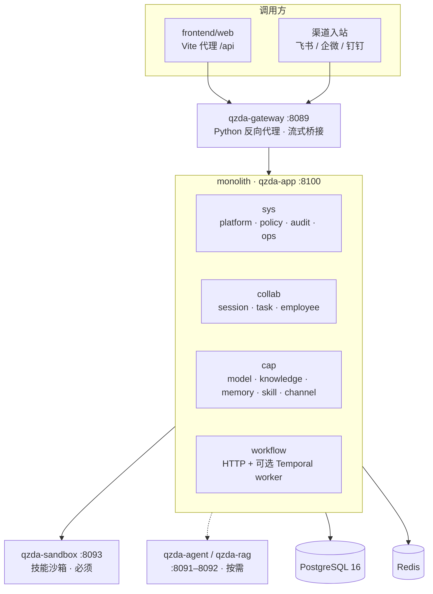
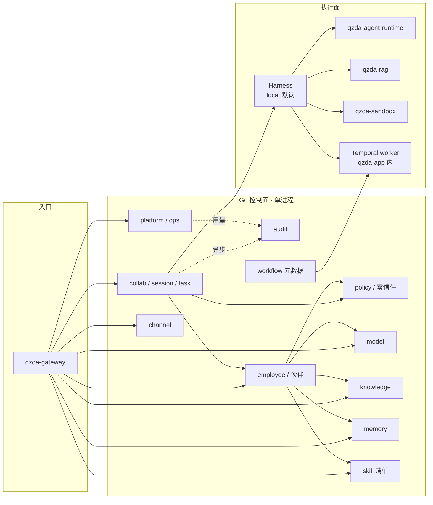
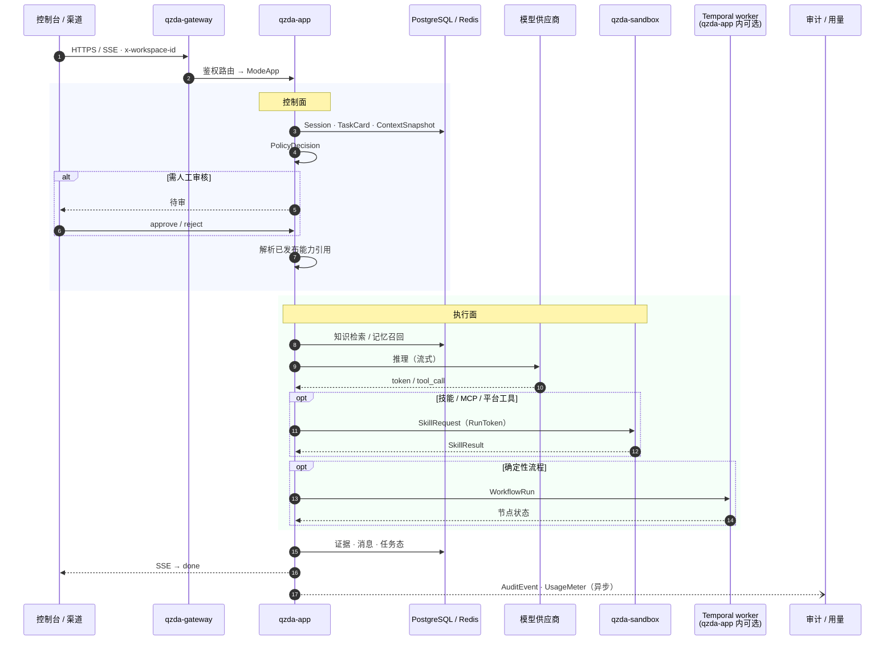

# Backend（控制面与执行面）

企智搭 · 数字伙伴平台后端：Go 控制面（身份、策略、审计、资源编排）+ Python 执行面（Agent / RAG / Skill 沙箱）。

| 项 | 默认 |
|----|------|
| **本地拓扑** | **monolith**：`qzda-gateway:8089` → `qzda-app:8100` + `qzda-sandbox:8093` |
| **数据** | Docker Postgres 16 + Redis；禁止 Homebrew 抢占 `5432` |
| **环境** | `QZDA_MODE=dev`（空库 hydrate，不灌 ACME seed） |

配套文档：

| 文档 | 用途 |
|------|------|
| [docs/README.md](../docs/README.md) | 功能模块文档索引（M01–M16 分册） |
| [deploy/topology-split.md](deploy/topology-split.md) | monolith 拓扑说明 |
| [deploy/MIGRATION-de-to-qzda.md](deploy/MIGRATION-de-to-qzda.md) | Phase 3 外部集成迁移指南(OIDC client / Kafka 包名 / SPIFFE trust domain) |
| [api/routes.md](api/routes.md) | HTTP 路由契约 |
| [api/models-contract.md](api/models-contract.md) | 模型服务字段级契约（M0 冻结） |
| [api/proto/README.md](api/proto/README.md) | Connect-RPC / Protobuf IDL 位置 |
| [../CHANGELOG.md](../CHANGELOG.md) | 三阶段品牌迁移总账 |

服务与组件文档：

| 文档 | 内容 |
|------|------|
| [cmd/qzda-app/SERVICE.md](cmd/qzda-app/SERVICE.md) | monolith 控制面职责与端口 |
| [internal/copilot/README.md](internal/copilot/README.md) | M02 专家协作包内说明（路由 → ReAct → 工具 → SSE） |
| [infra/postgres/SERVICE.md](infra/postgres/SERVICE.md) · [infra/redis/SERVICE.md](infra/redis/SERVICE.md) | 数据依赖口径 |
| [services/qzda-gateway/SERVICE.md](services/qzda-gateway/SERVICE.md) | :8089 入口代理 |
| [services/qzda-rag/SERVICE.md](services/qzda-rag/SERVICE.md) | :8092 RAG（pgvector / vector-memory） |
| [services/qzda-sandbox/SERVICE.md](services/qzda-sandbox/SERVICE.md) | :8093 技能沙箱 |
| [services/qzda-agent-runtime/README.md](services/qzda-agent-runtime/README.md) | :8091 agent 运行时 sidecar |

---

## 目录

- [架构总览](#架构总览)
- [模块交互图](#模块交互图)
- [数据流时序图](#数据流时序图)
- [部署单元](#部署单元)
- [代码结构](#代码结构)
- [快速开始](#快速开始)
- [Compose 与进程命令](#compose-与进程命令)
- [冷启动与办公开箱](#冷启动与办公开箱)
- [持久化与硬删除](#持久化与硬删除)
- [关键 API 摘要](#关键-api-摘要)
- [关键环境变量](#关键环境变量)
- [测试与冒烟](#测试与冒烟)

---

## 架构总览

**控制面管可信与编排，执行面跑推理与工具，网关统一入口。**  
`qzda-app` 是单进程 monolith：sys / collab / cap / workflow 域逻辑共存于同一 Go 进程，`ModeApp` / `DomainAll` 吸收所有 collection。Temporal worker 可作为进程内 goroutine 启动（`QZDA_WORKFLOW_WORKER=1`）。



文档分层对照：

| 层 | 含义 | 后端现状 |
|----|------|----------|
| **L0** | 控制面联调 | monolith + sandbox 已通 |
| **L1** | 领域契约 | 工作区隔离、审核、零信任语义已落地 |
| **L2** | 底座 | Temporal / Milvus / 真 gVisor 按阶段补齐 |

---

## 模块交互图

产品能力域全部在 `qzda-app` 单进程内的依赖关系：



| 域 | 职责 | 部署 |
|----|------|------|
| **sys** | 工作区、设置、策略、审计、运营聚合 | qzda-app 单进程 |
| **collab** | 会话、任务、审核、流式回合 | qzda-app 单进程 |
| **employee** | 岗位、装配、上岗 | qzda-app 单进程 |
| **cap** | 模型 / 知识 / 记忆 / 技能 / 渠道 | qzda-app 单进程 |
| **workflow** | 流程 HTTP、试运行 | qzda-app 单进程 |
| **workflow Temporal** | 流程编排（可选） | qzda-app 进程内 goroutine |
| **sandbox** | 沙箱执行 | 必须独立 :8093 |

已退役：`qzda-core`、细端口 `qzda-policy:8094` / `qzda-audit:8095`、独立 `qzda-policy:8104` / `qzda-audit:8105`、`qzda-sys:8100` / `qzda-collab:8101` / `qzda-cap:8102` / `qzda-workflow:8103`（M10 折叠到 qzda-app）。

---

## 数据流时序图

专家协作发一条消息（monolith；高风险写操作可插入人工审核）：



`QZDA_RUNTIME_MODE=local`（默认）：进程内 Harness。  
`QZDA_RUNTIME_MODE=remote`：回合经 `qzda-agent-runtime` `POST /v1/run` SSE。  
完整扇出见 [api/routes.md](api/routes.md)。

---

## 部署单元

| 单元 | 端口 | 说明 |
|------|------|------|
| **qzda-gateway** | 8089 | Python 代理 `services/qzda-gateway/main.py`；健康检查 `/healthz` |
| **qzda-app** | 8100 | **monolith 单进程**：sys + collab + cap + workflow,可设 `QZDA_WORKFLOW_WORKER=1` 启用进程内 Temporal worker |
| **qzda-sandbox** | 8093 | 技能沙箱（**必须**） |
| qzda-agent / qzda-rag | 8091–8092 | Python sidecar,按需 |

切流要点：

- 策略评估在 qzda-app 进程内由 `internal/policy.Engine` 处理；`/api/zero-trust/evaluate` 与 `/v1/evaluate` 都直接走本进程
- 审计写入本进程本地 sink（PG / Redis / Kafka / OpenSearch）
- 多活最小集：`QZDA_REPLICA_MODE=standby` 拒写；优先 `QZDA_DATABASE_REPLICA_URL`（指向外部从库；本仓无从库 compose target）

---

## 代码结构

```text
backend/
├── cmd/                       # 进程入口
│   ├── qzda-app/                # monolith 主进程（默认，唯一部署入口）+ Dockerfile/SERVICE.md
│   └── qzda-local-llm/          # 本地模型辅助
├── builtin/                   # 出厂包（冷启动 EnsureBuiltin*）
│   ├── knowledge/office/      # kp.{hr,admin,sales,market}.* 办公开箱知识（人事/行政/销售/市场 10 包）
│   ├── skills/                # 岗位包 manifest（office / general …）
│   ├── workflows/             # wf.office.* + 部门 Certified + 高级库
│   └── scenarios/office/      # 知识·技能·流程三联
├── internal/                  # 业务实现（handler 仍集中于此）
│   ├── apprun/                # 进程启动、hydrate、ensure、Persist
│   ├── server/                # HTTP/Connect · ServiceMode 路由
│   ├── store/                 # 内存态 + PG 快照 / kernel 表
│   ├── policy/ · auth/        # 策略引擎、身份
│   ├── depolicy/ · deaudit/ · deworkflow/
│   ├── modelprov/ · vault/    # 模型供应商、凭据引用
│   ├── runtimeenv/            # 运行时环境
│   └── feishu/ · wecom/ · dingtalk/ · weixin/
├── api/                       # routes.md · proto · 契约说明
├── services/                  # Python sidecar 集群（每服务一目录）
│   ├── qzda-gateway/          # Python 反向代理
│   ├── qzda-sandbox/          # 技能沙箱 · 必须独立
│   ├── qzda-rag/              # FastAPI RAG
│   └── qzda-agent-runtime/    # Python agent 运行时 sidecar
├── deploy/                    # compose · migrations · topology-split · networks
├── infra/ · obs/              # 基础依赖与可观测
├── libs/ · pkg/ · gen/        # hexkit 等与 buf 生成代码
├── scripts/                   # purge-demo-seed-ids.sql 等
├── bin/                       # make build 产物（LaunchAgent 读取）
├── buf.yaml · buf.gen.yaml
├── go.mod
└── Makefile
```

| 路径 | 说明 |
|------|------|
| `cmd/qzda-app` + `internal/apprun` | 本地主路径入口与启动编排 |
| `internal/server` | 路由与领域 handler（六边形迁包进行中） |
| `builtin/` | 知识 / 技能 / 流程 / 场景出厂源 |
| `cmd/qzda-app/SERVICE.md` | Go 单进程运维参考(port/env/启动) |
| `services/*/SERVICE.md` | Python sidecar 运维参考 |
| `bin/qzda-*` | 改 Go 后须 `make build` 再 kickstart |

---

## 快速开始

本机联调前确保 Docker Postgres 16（勿用 Homebrew 占 `5432`）：

```bash
# 仓库根目录
bash scripts/dev-stack/ensure-docker-postgres.sh
# 或
cd backend && make infra-env
```

```bash
cd backend
make infra-env             # 校验 / 拉起 Docker Postgres 16
make compose-up            # 起 Docker PG + Redis
make run-app               # 起宿主机控制面 :8100
make smoke                 # 经 :8089 验收（需栈已在跑）
```

前端：

```env
VITE_API_MODE=api
VITE_API_BASE=
# Vite 默认代理 → http://127.0.0.1:8089
```

| 邮箱前缀 | 角色 | 说明 |
|---------|------|------|
| `admin@` | admin | 全量写；上架/上岗可自批 |
| `audit@` | auditor | 治理 / 审计只读 |
| 其他 | user | 写操作须管理员审批 |

dev 模式下 `mock-*-token` 与 `x-mock-*` 身份头可用；pro 模式下两者都被拒绝，登录签发 JWT。

改 Go 后：

```bash
make build
launchctl kickstart -k "gui/$(id -u)/com.qizhida.dev-stack"
```

---

## Compose 与进程命令

| 命令 | 说明 |
|------|------|
| `make infra-env` | 校验 / 拉起 Docker Postgres 16（写 `deploy/.env`） |
| `make compose-up` | 起 Docker PG + Redis（仅这两个） |
| `make compose-down` / `compose-ps` / `compose-logs` | 停 / 看 / 跟日志 |
| `make run-app` | **主路径**：宿主机起控制面 `:8100`（`QZDA_MODE=dev`） |
| `make run-demo` | 内存 ACME seed，不写 PG |
| `make run-dev` | `infra-env` + `run-app` |
| `make build` | 编 `bin/qzda-app` 与 `bin/qzda-local-llm` |
| `make test` | `go test ./...` |
| `make smoke` | 经 `:8089` 探 workspaces / skills / sessions / evaluate |
| `make db-reset-dev` | drop schema（危险：丢应用数据） |
| `make verify-builtins` / `vet-builtins` / `skill-gate` | 技能签名与危险模式门禁 |

进程内 Temporal worker：给 `run-app` 加 `QZDA_WORKFLOW_WORKER=1` + `QZDA_TEMPORAL_HOST=<host:port>`（或在 `run-stack.sh` 上设 `QZDA_WITH_WORKFLOW=1`）。

全栈一条命令（含 gateway / 沙箱 / RAG / 前端）：仓库根 `make run-app`；单看某个端口用 `make run-app-status` / `make run-app-stop`。

网络：[`deploy/networks.md`](deploy/networks.md) · 拓扑：[`deploy/topology-split.md`](deploy/topology-split.md)。

---

## 冷启动与办公开箱

`apprun` 在非 `demo` 模式下 `store.NewEmpty()` + PG hydrate，**禁止**空库灌演示 seed。

冷启动的完整步骤（建 schema → 挂持久化钩子 → hydrate → builtin 技能/知识/流程 ensure → 内存态补充）见 **[附录B §B.7 冷启动行为](../docs/附录B-运行模式与本地起停.md#b7-冷启动行为)**。builtin 资产源码在 `builtin/{knowledge,skills,workflows,scenarios}/`，说明见各子目录 README 与 [附录A 跨模块底座](../docs/附录A-跨模块底座.md)。

平台工具（`knowledge.retrieve` 等）为 Harness **内置**，不经岗位包安装。

---

## 持久化与硬删除

| 模式 | 行为 |
|------|------|
| `QZDA_MODE=dev` + `QZDA_DATA_BACKEND=memory` | 内存 store，不 Persist |
| `QZDA_MODE=dev` + `QZDA_DATA_BACKEND=pg`（默认） / `QZDA_MODE=pro` | PG hydrate；Upsert 写回；**硬删必须 `PersistDelete(Sync)`** |

多数集合是 Upsert：只改内存再 `Persist` **不会**删掉 PG 旧行。硬删路径（哪些集合该调 `PersistDelete(Sync)`、kernel 表走 `KernelStore.DeleteMany`、记忆为何是软删）见 **[附录B §B.8 硬删除必须走 PersistDelete](../docs/附录B-运行模式与本地起停.md#b8-硬删除必须走-persistdelete)**。

清理历史 ACME seed：

```bash
psql "$QZDA_DATABASE_URL" -f scripts/purge-demo-seed-ids.sql
# 或 make db-reset-dev（危险：丢全部数据）
```

工作区：`x-workspace-id` 不在成员集合内 → **403**（见[附录B §B.9](../docs/附录B-运行模式与本地起停.md#b9-工作区-header-不可伪造)）。
---

## 关键 API 摘要

### 技能岗位包

| API | 说明 |
|-----|------|
| `GET /api/skills/packs` | 岗位包 + 当前工作区 `installed*` + `platformTools` |
| `POST /api/skills/apply-pack/:id` | 安装到当前工作区；`heavy-optin` 须审批单 |

### 专家协作（collab）

| 能力 | 路由 / 行为 |
|------|-------------|
| 会话 CRUD | `GET/POST/PATCH/DELETE /api/sessions`；非 admin 仅见本人；DELETE → PersistDelete |
| 对话详情 | `GET /api/conversations/:id` |
| 流式回合 | `POST …/stream`；结案/交接中拒绝写入 |
| 模式切换 | `PATCH /api/sessions/:id` → `sessionMode` |
| 单人审核 | `POST /api/actions/:id/approve`（发起人不可自批） |
| 附件 / 分享 | `/api/attachments` · `/api/share` |
| 限流 | 回合频控、`clientMsgId` 幂等；网关 Copilot 超时约 180s |

完整路由：[`api/routes.md`](api/routes.md)。

---

## 关键环境变量

| 变量 | 说明 |
|------|------|
| `QZDA_MODE` | `dev`（默认）\| `pro`；见 [附录B](../docs/附录B-运行模式与本地起停.md) |
| `QZDA_DATA_BACKEND` | 仅 dev 生效：`pg`（默认）\| `memory`（内存 + ACME seed） |
| `QZDA_DATABASE_URL` / `QZDA_REDIS_URL` | PG / Redis |
| `QZDA_APP_ADDR` / `QZDA_LISTEN_ADDR` | monolith 监听（默认 `:8100`） |
| `QZDA_SERVICE` | 兼容字段，归 `app`；旧值（`sys` / `collab` / `cap` / `workflow`）也归 `app` |
| `QZDA_DATABASE_REPLICA_URL` | standby 从库 DSN（`QZDA_REPLICA_MODE=standby` 时生效；本仓不提供从库 compose） |
| `QZDA_AGENT_RUNTIME_URL` / `QZDA_RAG_URL` / `QZDA_SANDBOX_RUNTIME_URL` | 侧车 |
| `QZDA_RUNTIME_MODE` | `local`（默认）或 `remote` |
| `QZDA_RUNTIME_FAILOVER_LOCAL` | 非生产 remote 失败可回落 local |
| `QZDA_SANDBOX_TEST_SIM` | 开发默认开；生产强制关 |
| `QZDA_SANDBOX_RUN_SECRET` | RunToken HMAC |
| `QZDA_TEMPORAL_HOST` | 非空则启用进程内 Temporal worker；生产/staging 默认 fail-closed |
| `QZDA_WORKFLOW_WORKER` | `1` 启用 qzda-app 进程内 Temporal worker（需 `QZDA_TEMPORAL_HOST`） |
| `QZDA_MODEL_BUDGET_ENFORCE` | 用量硬门禁；生产默认开 |
| `QZDA_REPLICA_MODE` | `active`（默认）或 `standby` |
| `QZDA_INSTANCE_ID` | 实例标识 |
| `QZDA_EVAL_RECALL_MIN` / `QZDA_EVAL_SCORE_MIN` | 生产评测门禁 |
| `QZDA_BUILTIN_WORKFLOWS_DIR` | 覆盖流程包路径 |

---

## 测试与冒烟

```bash
make test && make smoke
```

`make smoke` 经 `:8089` 探测 workspaces / skills / sessions / evaluate 等主路径。

沙箱 Python 自检（脚本式，非 pytest 收集）：

```bash
python3 services/qzda-sandbox/tests/test_runtoken.py
```

CI（[`.github/workflows/backend-contract.yml`](../.github/workflows/backend-contract.yml)）：PR/`main` 跑 `go test ./...` + IDL/路由契约探针 + Python smoke；完整 monolith smoke 仅 `workflow_dispatch`。
